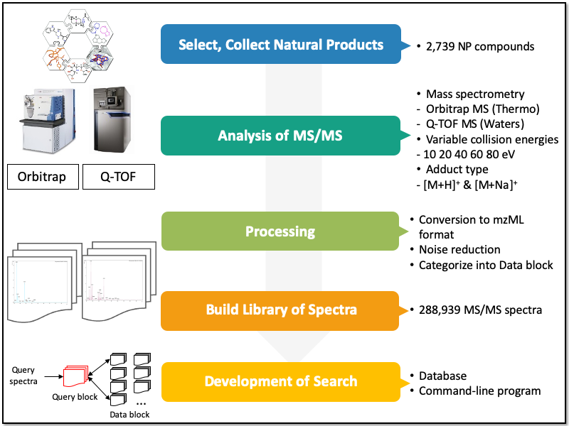

# bmdms-np
BMDMS-NP is a database that encompasses ESI MS/MS mass spectra of natural compounds, especially plant secondary metabolites. At present, the database contains 288,939 MS/MS spectra of 2,739 natural compounds that are commercially available.



## Notice: database access (updated November 2026)
Following a change in our institute's network security policy, the BMDMS-NP MySQL server is **no longer reachable from outside our internal network**. The server address and account described in earlier versions of this repository and in the "How to use the BMDMS-NP" slides no longer work.

Instead, an export of the two database tables, `info_compound` and `info_spectrum`, is available as a JSON file on request. Please send an email to Sangwon Lee (sw.lee@yonsei.ac.kr).

## Data access
### JSON export
* The file contains the `info_compound` and `info_spectrum` tables for all compounds and spectra. The two tables are linked through the `c_id` column.
* JSON is used instead of CSV because some compound names contain commas or quotation marks.
* `collision_energy` values (10, 20, 40, 60 and 80) are in **eV**, not normalized collision energy (NCE, %).
* `instrument_type` values:
  * `Orbitrap`: Orbitrap Elite mass spectrometer (Thermo Scientific), fragmentation by HCD
  * `QTOF`: SYNAPT G2-S MS (Waters), fragmentation by CID

### Peak data
In the database, the peaks of each spectrum are stored as a NumPy array serialized with `np.save()` into `io.BytesIO()` (see `adapt_array()` and `convert_array()` in `database/info_spectrum_mysql.py`). In the JSON export, these binary values are written as hexadecimal strings prefixed with `0x`. Each one decodes to an array of shape (n, 2) with m/z and intensity columns:

```python
import io
import numpy as np

peaks = np.load(io.BytesIO(bytes.fromhex(record["peaks"][2:])))  # columns: m/z, intensity
```

### GNPS version
BMDMS-NP is also distributed through GNPS. When the library was deposited, GNPS assigned its own spectrum IDs and reprocessed the spectra to its own standards; our `spec_id`, collision energy and instrument type were not retained. GNPS records therefore cannot be matched to the database by order or ID. To link them, compare spectra by similarity (e.g. cosine with an m/z tolerance) among spectra that share the same InChIKey and precursor type.

## Dependencies
1. Anaconda for python 3.7 and create & activate a virtual environment

2. JRE 8.0

3. Numpy
		
		conda install -c anaconda numpy
4. SQLAlchemy

		conda install -c anaconda sqlalchemy	
5. Pymysql

		conda install -c anaconda pymysql
6. Scikit Learn

		conda install scikit-learn
7. Pymzml

		conda install -c bioconda pymzml
8. RDKit

		conda install -c rdkit rdkit
9. Jpype1
		
		conda install -c conda-forge jpype1
10. PyFingerprint

		pip install git+git://github.com/hcji/PyFingerprint@master

11. Matplotlib-venn (optional)

		conda install -c conda-forge matplotlib-venn

12. Clone the code

		git clone https://github.com/chalbori/bmdms-np.git
  
## Usage
* To check molecular structures of compounds included in database, SDFiles in the folder out/sdfs/ are being provided.
* Take sample/search_block_pymzml.py or sample/search_block_pyopenms.py as examples for running as described in the file.
* To parse all spectral records to MSP format file, please run sample/retrive_records.py
* The sample scripts read the database connection settings from `database/accounts.py`. They require a MySQL/MariaDB database that you host yourself; set the connection settings in that file accordingly.

## Citation
If you use BMDMS-NP, please cite:

Lee, S., Hwang, S., Seo, M., Shin, K.B., Kim, K.H., Park, G.W., Kim, J.Y., Yoo, J.S., No, K.T., 2020. BMDMS-NP: A comprehensive ESI-MS/MS spectral library of natural compounds. *Phytochemistry* 177, 112427. https://doi.org/10.1016/j.phytochem.2020.112427
